# QA de Fase 1 — UMBRAL

## Entorno

- Windows x86_64, Godot **4.7.2.stable.official.ed1daf0bf**, Standard (GDScript), descargado desde el [archivo oficial de Godot](https://godotengine.org/download/archive/4.7.2-stable/).
- Rama local: `fix/umbral-mvp-fase1-qa`; proyecto Forward+.
- Prueba renderizada con Vulkan 1.4.341 en NVIDIA GeForce RTX 4060 Laptop GPU.

## Cambios de Misión 02

- `scripts/player_controller.gd`: al alternar cámara registra `Time.get_ticks_usec()` y publica/imprime la duración cuando `SpringArm3D.spring_length` alcanza el destino.
- `scripts/world_prototype.gd`: carteles usan billboard, escala positiva y tamaño reducido; el cartel del patio se movió al lado izquierdo y por encima del muro. La iluminación ambiental mínima nocturna subió de 0.10 a 0.18.
- `scripts/world_pickup.gd`: reduje fuente y escala de los rótulos que se recortaban en el borde derecho.
- `tests/test_interactive.gd` y `tests/interactive_tests.tscn`: nueva suite renderizada con eventos inyectados, flujo E2E, captura en `RenderingServer.frame_post_draw` y medición de 10 s de FPS.
- `tests/test_inventory.gd`: conserva la regresión de Misión 01 para peso límite y rollback transaccional.
- `README.md`: añadí el comando de prueba interactiva, métricas de referencia y ruta de captura.

## Evidencia

| Verificación | Resultado | Evidencia |
|---|---|---|
| Versión real | PASS | Godot `4.7.2.stable.official.ed1daf0bf` |
| Importación | PASS | `--headless --path . --import`, código 0; sin errores de script ni de carga |
| Suite original | PASS | `--headless --path . res://tests/inventory_tests.tscn`: **39 PASS, 0 FAIL**, código 0 |
| Arranque original | PASS | `--headless --path . res://scenes/main.tscn --quit-after 180`, código 0, sin errores |
| Test unitario de acción | PASS | `Input.is_action_pressed()` confirma W/A/S/D con `InputEventKey` inyectados desde GDScript |
| Prueba de entrada inyectada | PASS | `Input.parse_input_event()` verifica desplazamiento W, cámara V, inventario Tab, pickup E y linterna F; también inyecta movimiento de ratón y clic izquierdo sobre receta |
| E2E del jugador | PASS | **26 PASS, 0 FAIL**, código 0. W mueve; E recoge tela y hierba, elimina cada pickup y actualiza cantidades; Tab abre; clic fabrica Vendaje; Tab cierra; F enciende y se verifica drenaje de batería |
| Transición renderizada de cámara | PASS | Medición monotónica **187.350 ms**, por debajo del límite de 300 ms |
| FPS promedio | PASS | **137.59 FPS** promedio durante 10 segundos de movimiento; 97 muestras con `Performance.TIME_FPS` en la ventana renderizada 1920×1080 |
| Auditoría visual nocturna | PASS | Captura revisada: cartel del patio completo, no invertido y dentro del encuadre; rótulo de pickup derecho contenido; escenario visible sin linterna |
| Foco/controles físicos manuales | **BLOCKED** | Los eventos de motor se probaron inyectados. No se hizo recorrido con periféricos físicos; la prueba automatizada no acredita sensación/foco manual de ratón |
| FPS en otros equipos | **BLOCKED** | La única medición corresponde a la RTX 4060 Laptop disponible; no representa otros equipos/GPU |

### Salida de referencia de la prueba interactiva

```text
CAMERA_TRANSITION_MS: 187.350
PASS: Test unitario de acción: W -> move_forward
PASS: Test unitario de acción: A -> move_left
PASS: Test unitario de acción: S -> move_backward
PASS: Test unitario de acción: D -> move_right
PASS: Prueba E2E: E aumenta inventario
PASS: Prueba de entrada inyectada: clic fabrica vendaje
PASS: Prueba E2E: batería drena con linterna encendida
PASS: Cartel del patio proyectado dentro del encuadre
PASS: Captura renderizada guardada (1920x1080)
FPS_AVERAGE_10S: 137.59
TOTAL_INTERACTIVE: 26 PASS | 0 FAIL
INTERACTIVE_EXIT=0
```

Captura producida en el test mediante `RenderingServer.frame_post_draw`: [tests/artifacts/umbral_mission02.png](../tests/artifacts/umbral_mission02.png). El viewport entregó 1920×1079 por el alto de ventana disponible; el test ajustó la salida PNG a 1920×1080.

## Verificaciones que siguen pendientes

1. Probar con periféricos físicos si se requiere validar el ratón real y el foco percibido de UI.
2. Medir FPS en los equipos objetivo adicionales antes de fijar una garantía de rendimiento.

## Alcance

Se conserva Fase 1. No se implementaron enemigos, combate, mapa multi-zona, chunks, streaming, floating origin, guardado mundial ni HLOD.

## Misión 03 — Rediseño visual, game feel y UX/UI

### Resultados verificados (Godot 4.7.2 Standard, RTX 4060 Laptop)

| Verificación | Estado | Evidencia |
|---|---|---|
| Importación | PASS | `--headless --path . --import`; finalizó sin errores ni warnings de script |
| Suite original de inventario | PASS | `inventory_tests.tscn`: **39 PASS, 0 FAIL** |
| Suite E2E previa + regresiones M03 | PASS | `interactive_tests.tscn`: **32 PASS, 0 FAIL**; conserva las 26 verificaciones E2E existentes y añade seis comprobaciones M03 |
| Arranque de escena principal | PASS | `--headless --path . res://scenes/main.tscn --quit-after 180`; sin salida de error |
| Inyección y flujo E2E | PASS | `Input.parse_input_event`: W/A/S/D, W mueve, V alterna cámara, E recoge, Tab abre, clic fabrica vendaje, F enciende linterna y drena batería |
| Alternancias de cámara | PASS | 10 alternancias automatizadas completadas; mediciones observadas entre **179.790 y 194.392 ms** (<300 ms) |
| FPS después | PASS | 10 s de movimiento nocturno con linterna activa y alternancias de cámara cada segundo: promedio **141.22 FPS**, p95 **144 FPS**, p99 **144 FPS** (97 muestras, RTX 4060 Laptop; límite observado de 144 FPS) |
| FPS antes p95/p99 | BLOCKED | El registro de Misión 02 solo conservó promedio **137.59 FPS**; no hay muestras crudas para calcular percentiles retrospectivos |
| Hardware iGPU | BLOCKED | No hay GPU integrada de referencia disponible en este entorno |
| Revisión humana de game feel y onboarding <90 s | BLOCKED | La automatización comprueba entradas/estado; no mide percepción de control ni tiempo de aprendizaje de una persona |
| Proporciones humanas / rig | BLOCKED parcial | El modelo sustituto low-poly tiene silueta, chaqueta, cargo, botas y mochila, pero sigue construido con piezas paramétricas. No hay `Skeleton3D` ni rig importado; la animación procedural de extremidades se mezcla mediante `AnimationTree`/`BlendSpace2D`. El criterio humano a 10 m y ausencia de foot sliding requieren revisión visual humana. |
| Audio ambiental y aterrizaje | BLOCKED | Se conservaron sonidos de pickup/crafting/error; no se añadieron ni midieron viento, pasos o feedback de aterrizaje. |
| Capturas PRE/POST | PASS | Cuatro pares 1920×1080 guardados bajo `tests/artifacts/mission03/{before,after}/`; captura posterior generada en renderer Vulkan mediante `RenderingServer.frame_post_draw` |

### Capturas comparativas

| Plano | PRE | POST |
|---|---|---|
| Patio diurno | 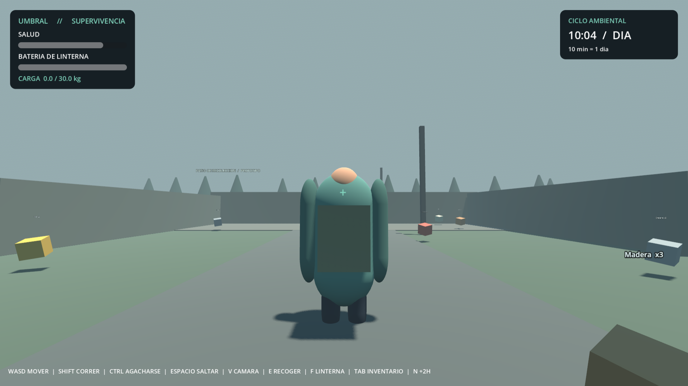 |  |
| Refugio | 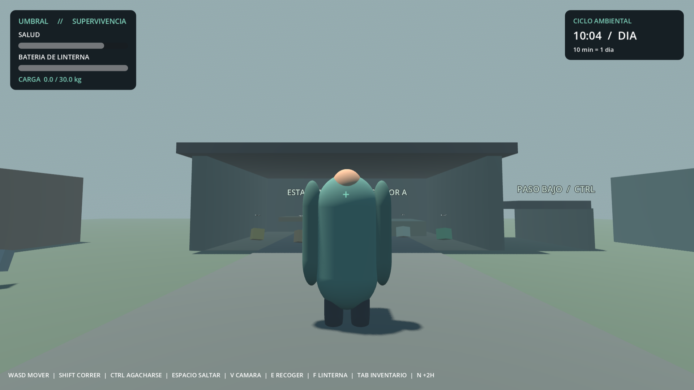 | 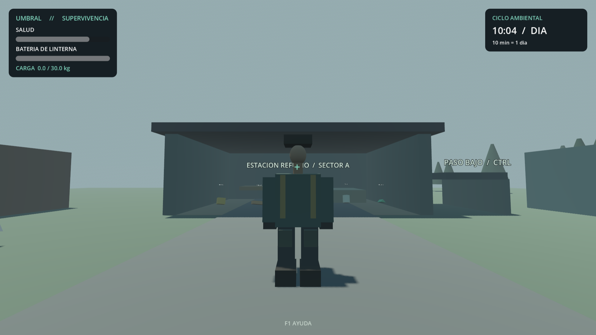 |
| Inventario | 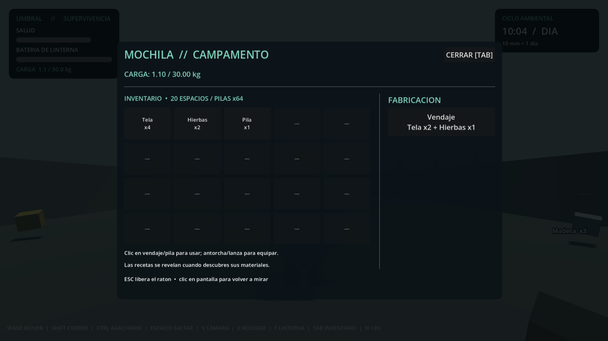 |  |
| Noche | 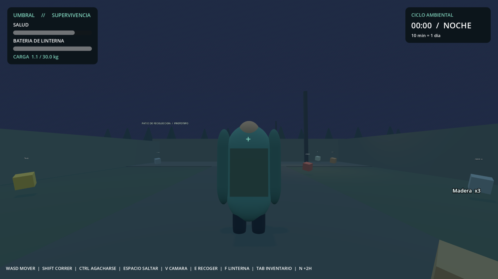 |  |

### Cambios M03

- Superviviente geométrico low-poly con ropa diferenciada y movimiento alternado de brazos/piernas; `AnimationPlayer`, `AnimationTree` y `BlendSpace2D` activos.
- Escena de Fase 1 ampliada con taller/estación, acceso vial, vehículo abandonado, señal de salida, radio y vegetación por grupos MultiMesh con visibilidad limitada. Pickups usan siluetas diferentes para tela, hierbas, madera, chatarra y pilas.
- Luz ambiental nocturna ligeramente elevada, niebla reducida, F1 abre ayuda contextual y el inventario presenta iconos, ordenación y estado de recetas. Sensibilidad, inversión Y y FOV se pueden ajustar desde la ayuda y guardan en `user://settings.cfg`.
- La animación de locomoción se genera localmente. No se añadió esqueleto deformable/Skeleton3D; los rótulos de pickup siguen usando texto 3D, y no se añadieron pasos ni viento.
- Procedencia: [docs/ASSET_PROVENANCE.md](ASSET_PROVENANCE.md). No hay assets externos.

## Misión 04 — assets reales, animación riggeada y audio

### Resultados verificados (Godot 4.7.2 Standard, Windows x86_64, RTX 4060 Laptop)

| Verificación | Estado | Evidencia |
|---|---|---|
| Importación de assets y scripts | PASS | Godot 4.7.2, importación headless finalizada sin mensajes ERROR/SCRIPT ERROR. |
| Suite transaccional original | PASS | inventory_tests.tscn: 39 PASS, 0 FAIL. |
| Suite interactiva con renderer visible | PASS | interactive_tests.tscn: 36 PASS, 0 FAIL, código 0; incluye regresiones del rig, cinco animaciones y conteo de props. |
| Test unitario de acción | PASS | Comprueba W/A/S/D vía Input.is_action_pressed() tras inyectar InputEventKey. |
| Prueba de entrada inyectada | PASS | W mueve al jugador hacia el objeto; V cambia cámara; E recoge; Tab abre/cierra; movimiento de ratón enfoca receta; clic fabrica; F activa linterna y se mide drenaje. Eventos entregados mediante Input.parse_input_event(), sin automatización de escritorio. |
| E2E pickup-crafting-linterna | PASS | W reduce distancia al pickup; E lo elimina y suma inventario; Tab abre mochila; clic produce Vendaje; F activa linterna y batería decrece. |
| Esqueleto y animación | PASS | FBX Kenney contiene Skeleton3D con 58 huesos. AnimationTree activo con clips con tracks: idle, walk, run, jump, crouch. Walk retima Run y crouch reutiliza Idle. |
| Props auténticos | PASS | 14 glTF distintos de Kenney Survival Kit instanciados; regresión automatizada cuenta 14. |
| Texturas PBR | PASS | Mapas diffuse, normal y roughness 2K para asfalto, madera y metal, importados desde Poly Haven. |
| Audio | PASS | Viento ambiental en loop; pasos por superficie; golpe al aterrizar; pickup corto. Audio CC0 documentado en docs/ASSET_PROVENANCE.md. |
| Capturas PRE/POST | PASS | Renderer Vulkan; cuatro pares PNG 1920×1080. La prueba de captura usa RenderingServer.frame_post_draw: patio, refugio, inventario y noche bajo tests/artifacts/mission04/{before,after}/. |
| Transición de cámara | PASS | Medición con Time.get_ticks_usec(): 193.380 ms en la alternancia inicial, menor que 300 ms. |
| FPS promedio | PASS | 140.10 FPS promedio en 10 s de movimiento renderizado; 96 muestras, p95/p99: 145/145 FPS (límite observado por sincronización de pantalla). |
| Revisión literal de chaqueta y botas | BLOCKED | El modelo humano riggeado lleva camiseta de manga larga, pantalón y zapatillas; no cumple literalmente chaqueta ni botas robustas. No se presenta como PASS. |
| Percepción de control en periféricos físicos | BLOCKED | La entrada del motor se validó por inyección interna; no se juzga sensación de ratón/teclado físico ni percepción de la animación a distancia. |
| FPS en otros equipos | BLOCKED | Solo hay medición con RTX 4060 Laptop a 1920×1080. |

### Evidencia de ejecución

La salida final de consola registró: inventory_tests.tscn = TOTAL: 39 PASS | 0 FAIL; interactive_tests.tscn = TOTAL_INTERACTIVE: 36 PASS | 0 FAIL; CAMERA_TRANSITION_MS: 193.380; FPS_AVERAGE_10S: 140.10; FPS_P95_10S: 145.00; FPS_P99_10S: 145.00.

| Plano | PRE | POST |
|---|---|---|
| Patio diurno | 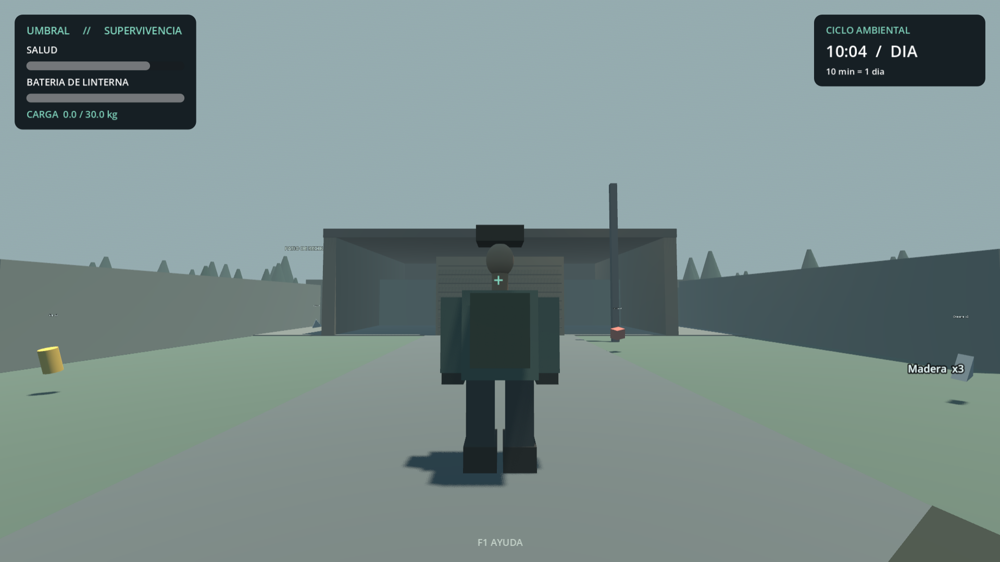 | 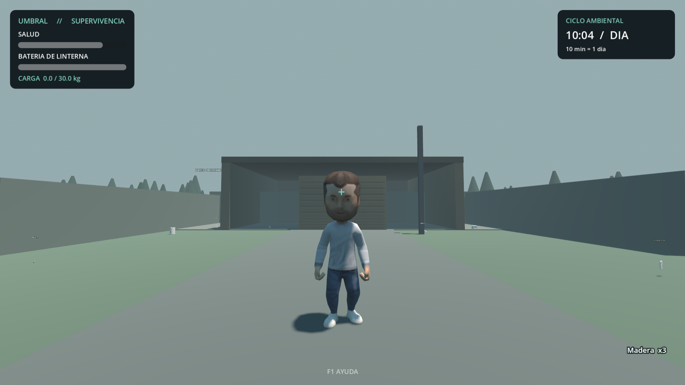 |
| Refugio |  | 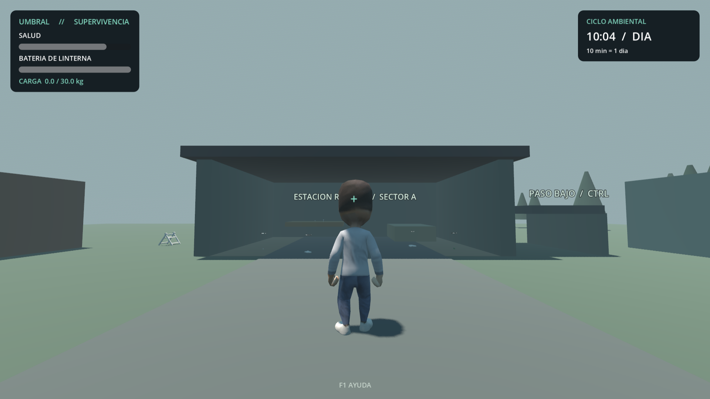 |
| Inventario | 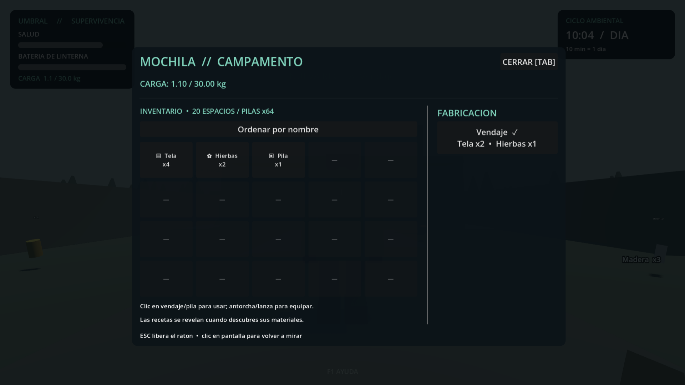 | 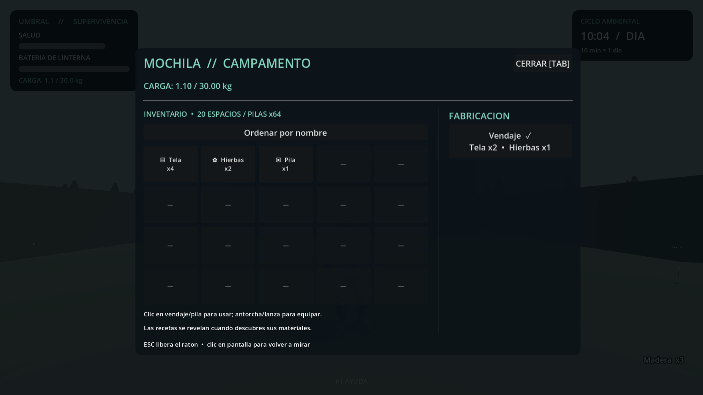 |
| Noche | 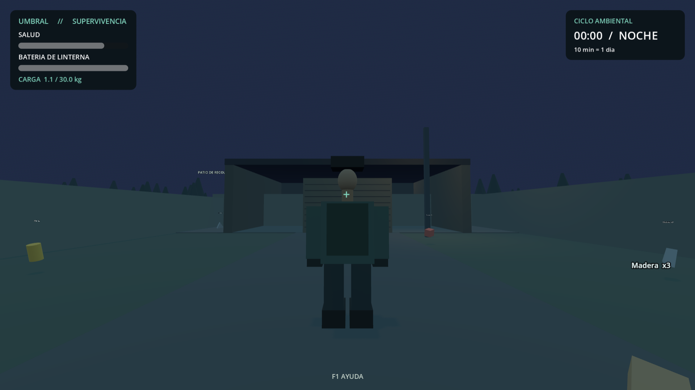 | 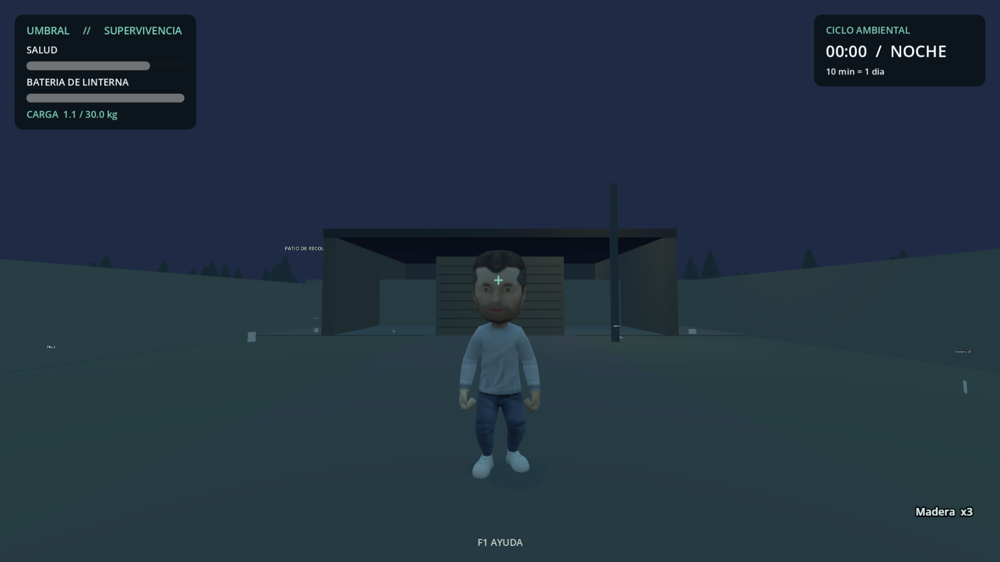 |

Los PNG POST son capturas reales del renderer mediante RenderingServer.frame_post_draw, no composiciones. La suite headless sirve para lógica, pero no sustituye estas capturas.

### Cambios M04

- El sustituto geométrico de personaje fue retirado. Se usa el FBX riggeado real de Kenney; AnimationTree mezcla clips importados y el hacha equipable, pickups y 14 props vienen del pack glTF.
- Asfalto, suelo de patio, madera de refugio y cubiertas metálicas tienen mapas PBR 2K de Poly Haven.
- Se añadieron grabaciones CC0 para viento, pasos por superficie, aterrizaje y feedback de pickup. El clip walk se retima para ajustar la velocidad.
- El HUD mantiene iconos representativos junto al texto de inventario. El sonido de pickup reproduce un fragmento corto.
- No se añadió enemigo, combate, mapa multizona ni streaming. El modelo no tiene chaqueta/botas robustas y esto permanece pendiente de un asset compatible con el rig.
- Inventario transaccional, datos JSON y límites de Fase 1 se mantienen; procedencia en ASSET_PROVENANCE.md.
